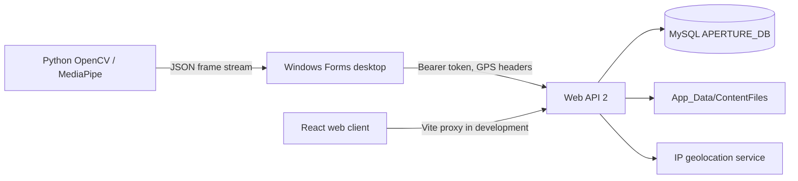

# Aperture architecture

The API and desktop both stay on **.NET Framework 4.7.2**. The API is ASP.NET Web API 2 hosted by IIS/IIS Express. All application metadata uses the existing MySQL schema; this integration needs no database migration.



## Components

| Component | Location | Responsibility |
|---|---|---|
| API | `Aperture WebAPI/Aperture WebAPI` | Authentication, sharing, policy checks, session lifecycle and audit |
| Desktop | `Aperture Desktop Client` | Sender controls, protected viewer, camera enforcement, Windows location reporting |
| Web | `web` | Dashboard, map-based sharing, editable conditions, browser location and secure viewer |
| Detector | `camera` | Local camera detection; setup creates `camera/venv` and desktop selects it automatically |
| Schema | `db/schema.sql` | Existing MySQL tables; the hosted schema is APERTURE_DB rather than railway |

The mobile app remains a UI prototype. The React viewer does not advertise camera support and is refused content requiring camera enforcement.

## Storage

`Users` stores account and password-hash records. `Content` stores sender/file metadata; the actual text/image bytes live in `App_Data/ContentFiles`. `ContentRecipient` assigns recipient access. `AccessPolicy.PolicyStatus` handles owner pause/resume; **AccessPolicy.Requirements** holds all restriction settings together:

```json
{
  "Version": 1,
  "StartTime": null,
  "ExpiresAt": "2027-01-01T00:00:00Z",
  "MaxViews": 3,
  "RequireTrustedDevice": true,
  "ScreenshotRestriction": false,
  "Location": { "Latitude": 26.37, "Longitude": -80.1, "RadiusMeters": 500 },
  "CameraRestrictions": { "Enabled": true, "BlockPhones": true, "BlockMultiplePeople": true, "RequireViewer": true }
}
```

Location may instead contain `Country`, `Region` and `City`. Null maximum views means unlimited; a positive integer limits total opens per recipient. All dates are UTC. Invalid documents and unsupported versions fail closed. Owner time/location edits use MySQL `JSON_SET` to preserve all other fields, including camera rules. Precise restrictions are included in the initial sharing transaction.

The schema has no device-key column. Registration stores `Desktop:<guid>` in `TrustedDevices.DeviceType`, keeping the friendly name separately. A per-user row lock serializes registrations; new devices are untrusted, and repeat registration preserves approval.

`ViewingSession` records opens and terminal closure. `EnvironmentCheck` records each opening/check decision, including suspended ones. `AuditLogs` records API requests without request/response bodies.

## Request flow

`Global.asax` registers Web API routes and `AuditLoggingHandler`. `[TokenAuthorize]` checks the bearer token, loads its account and sets `RequestUser` for the request. Controllers use parameterized `MySql.Data` commands. Newtonsoft returns PascalCase DTO properties and UTC dates, omitting nulls. `Web.config` supplies the connection and IP-geolocation settings.

A recipient opens content with its device key, camera protocol version and optional GPS headers. The API locks the recipient row while checking view counts and creating a session. It checks active access, time window, maximum opens, device approval, geographic restrictions, camera compatibility and screenshot requirements. On success it returns content and remembers the client IP/device binding in memory.

Every five seconds the client rechecks that same session with the latest location. The server checks the policy even during manual holds, so holds cannot delay revocation or terminal expiry. It never returns file bytes in a denied response.

| Outcome | Server behavior | Client behavior |
|---|---|---|
| All conditions pass | AccessGranted true; clears suspension | Restore content, subject to desktop camera guard |
| Missing GPS, outside area, changed IP, device unapproved or start moved into future | Suspended true, SessionEnded false; session remains Active | Hide/clear content, retain ID and poll; recovery consumes no extra view |
| Manual hold | Same session withheld for 1?3600 seconds | Restore only after hold ends and every condition passes |
| Existing session expires | Suspend for up to five minutes | Owner can extend the window; passing check restores the same session |
| Expiry beyond grace, invalid policy, unsupported camera, screenshot restriction or geolocation-provider failure | SessionEnded true; session closed | Clear content and require fresh authorization |
| Owner pauses or revokes | Close open sessions immediately | Next check is denied; no suspension can override it |

New sessions never open expired content. A manual hold is available to its recipient or content sender. Suspension status includes source, reason, start and optional hold deadline. A new failed condition replaces an expired manual hold's status.

## Clients

Desktop Share supports coordinates/radius and camera rules. Manage exposes time-window editing and allowed-area changes. The viewer supports device-location sharing and a 30-second server hold, retaining suspended session IDs. Windows location permission is required; fixes older than 30 seconds are withheld. Camera failures/stale frames independently hide content; ten safe frames are needed for recovery, and camera recovery cannot override a server denial.

React Share uses a map picker and saves the full rule in one request. Its secure viewer reports browser location, rechecks every five seconds and distinguishes suspension from terminal closure. It also hides when unfocused. Its dev proxy targets IIS Express at https://localhost:44353, using the matching upstream Host header.

## State and limits

Bearer tokens, IP/device session bindings and suspensions live in one IIS worker's memory; restart invalidates them. Successful IP lookups are cached for 15 minutes. The server uses the socket peer IP and deliberately ignores untrusted forwarded headers. Behind the development proxy that peer is the proxy, so production needs an explicit trusted-proxy design.

Client device keys and GPS values are not attestation and can be spoofed. IP geolocation is approximate. Previously obtained content cannot be recalled, and screenshots cannot be reliably blocked by these clients. The API refuses screenshot-restricted content rather than claiming it is protected.

See the API README for endpoint details and the unit and disposable HTTP test commands. The HTTP tests initialize a separate temporary MySQL instance and IIS site; they never change the configured application database.
